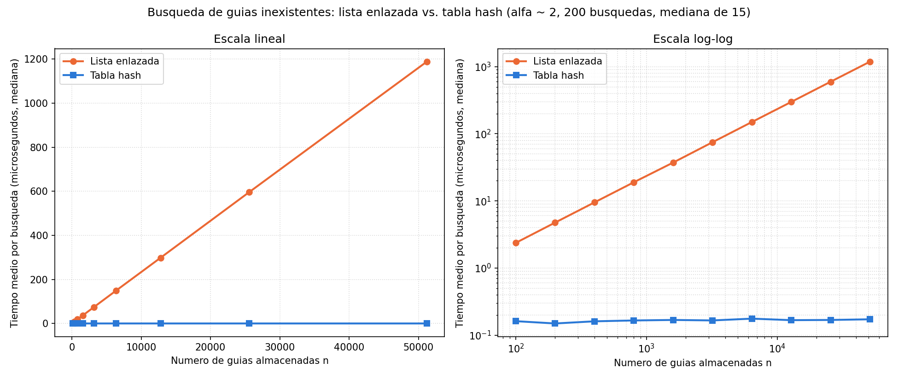
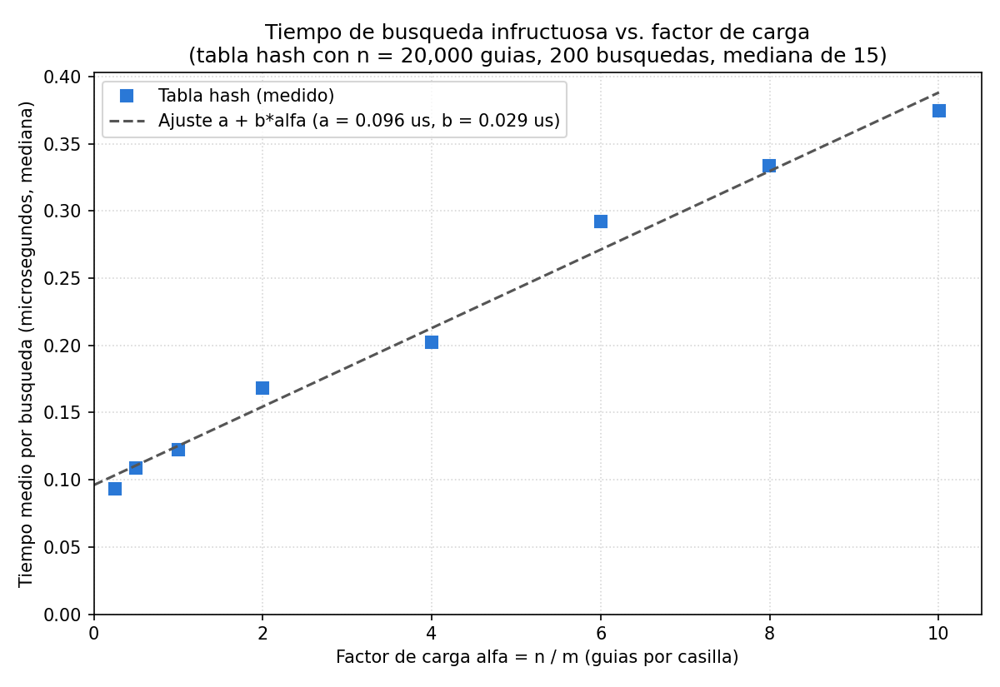

# Laboratorio evaluativo 03 — Estructuras de datos

**Autor:** Jhon Eduardo Zabala Garzon
**Correo:** jhonzabala329026@correo.itm.edu.co
**Grupo de Análisis:** 190304006-1
**Caso analizado:** Rutas del Caribe — consulta del estado de un envío por
número de guía (lista enlazada vs. tabla hash)

---

## Cómo reproducir el experimento

Todo el código se ejecuta con el entorno virtual de la raíz del repositorio,
que ya tiene `matplotlib` registrado en `requirements.txt`.

```bash
# 1. Clonar y entrar al repositorio
git clone https://github.com/EduardoZabala/curso-analisis-algoritmos.git
cd curso-analisis-algoritmos

# 2. Crear y activar el entorno virtual (si aún no existe)
python3 -m venv .venv
source .venv/bin/activate          # Windows: .venv\Scripts\activate

# 3. Instalar las dependencias registradas
pip install -r requirements.txt

# 4. Ejecutar las pruebas y la medición
cd lab3-estructuras-datos
python pruebas.py                  # Parte 1: casos con assert
python medicion.py                 # Parte 2: tablas + las dos gráficas + estimación
```

`pruebas.py` termina con `Todas las pruebas pasaron.`; si algún caso falla, se
detiene con un `AssertionError` que dice cuál. `medicion.py` tarda unos 12
segundos e imprime las tablas que aparecen en este informe. Las guías se
generan con semilla `42` y las inexistentes con semilla `7`, así que los datos
son idénticos en cualquier máquina; los tiempos cambian entre equipos, pero no
la forma de las curvas.

**Equipo donde se tomaron las mediciones de este informe:** Intel Core
i7-14700HX, 31 GB de RAM, Linux x86-64, CPython 3.14.7, matplotlib 3.10.6.

---

## Parte 1 — Implementar y verificar las dos estructuras

Código de esta parte: [`estructuras.py`](estructuras.py) (las dos clases) y
[`pruebas.py`](pruebas.py) (las pruebas).

- `ListaEnlazada.insertar` crea el nodo, lo apunta a la cabeza actual y lo
  vuelve la nueva cabeza: Θ(1), sin recorrer nada. `buscar` avanza con un
  `while` desde la cabeza y se detiene al encontrar la guía o al llegar a
  `None`.
- `TablaHash` tiene `m` casillas y cada una es una `ListaEnlazada`
  (encadenamiento). `hash` es `guia % m`; `insertar` y `buscar` calculan la
  casilla y delegan en su lista, de modo que solo recorren esa cadena.
  `factor_carga` devuelve `tamano / m`. No uso `dict`, `set` ni `hash()` de
  Python en ninguna de las dos clases.

**Cómo verifiqué.** Además de comparar respuestas, cuento los nodos de una
cadena siguiendo los enlaces (función `longitud`), para no confiar solo en el
contador `tamano` que mantiene el propio código.

| Caso | Qué se comprueba |
| --- | --- |
| Serie de ejemplo del enunciado (4 guías) | Las 4 se encuentran con su estado en lista y tabla; `1000000099` da `None` en ambas; la última insertada queda en la cabeza |
| Estructuras vacías | Toda búsqueda da `None` y el factor de carga es 0 |
| Colisión forzada, m = 7 | `hash` de 10, 24 y 17 es 3; las tres se encuentran; la cadena de la casilla 3 tiene longitud 3; 31 (también va a la 3) da `None`; las demás casillas quedan vacías salvo la 5 |
| Factor de carga | Exactamente `3 / 7` tras insertar 10, 24 y 17 |
| 50 colecciones aleatorias | n entre 1 y 600, m ∈ {1, 2, 7, 13, 97, 101, 997}, semilla 2026: para **todas** las guías existentes lista, tabla y estado esperado coinciden; para 100 guías inexistentes por colección ambas dan `None`; la suma de longitudes de las cadenas es n |

El caso m = 1 es a propósito: toda la tabla queda en una sola cadena, el peor
caso posible, y aun así debe responder igual que la lista.

---

## Parte 2 — Medir y graficar

Código de esta parte: [`medicion.py`](medicion.py).

**Cómo medí.**

- **Experimento A:** 10 valores de n en una cadena donde n se duplica
  (100, 200, 400, 800, …, 25.600, 51.200): cuatro menores de 1.000 y dos
  mayores de 20.000. Para cada n la tabla usa el **primo más cercano a n/2**
  (columna m), así α queda en 2.00 (2.13 en n = 100, donde los primos están
  más espaciados en proporción).
- **Experimento B:** n = 20.000 fijo y m = primo más cercano a n/α para
  α ∈ {0,25; 0,5; 1; 2; 4; 6; 8; 10}.
- Las guías son enteros distintos de diez dígitos (`random.sample`, semilla
  42). Lista y tabla se construyen con **las mismas guías** y la construcción
  queda fuera del reloj.
- Antes de medir, el script verifica en cada n (y en cada α) que 200 guías
  existentes devuelven el mismo estado en lista y tabla, y que las 200
  inexistentes dan `None` en ambas; si no, se detiene.
- Cronometro con `time.perf_counter()` **solo** el ciclo de 200 búsquedas de
  guías inexistentes (generadas con `generar_guias_inexistentes`) y divido por
  200. El recolector de basura se apaga durante la tanda.
- **Repetí cada tanda 15 veces y reporto la mediana**, como en el laboratorio
  anterior.



En escala lineal la tabla queda pegada al eje; el panel log-log permite leerla.

| n | m | α | Lista (µs) | Tabla (µs) | Lista / Tabla |
| ---: | ---: | ---: | ---: | ---: | ---: |
| 100 | 47 | 2.13 | 2.367 | 0.161 | 15 |
| 200 | 101 | 1.98 | 4.750 | 0.149 | 32 |
| 400 | 199 | 2.01 | 9.497 | 0.161 | 59 |
| 800 | 401 | 2.00 | 18.950 | 0.165 | 115 |
| 1600 | 797 | 2.01 | 37.267 | 0.168 | 222 |
| 3200 | 1601 | 2.00 | 74.895 | 0.165 | 453 |
| 6400 | 3203 | 2.00 | 149.804 | 0.176 | 851 |
| 12800 | 6397 | 2.00 | 298.451 | 0.167 | 1,787 |
| 25600 | 12799 | 2.00 | 596.591 | 0.168 | 3,548 |
| 51200 | 25601 | 2.00 | 1188.125 | 0.172 | 6,906 |

Factor por el que se multiplica el tiempo cuando n se duplica:

| n → 2n | Lista | Esperado Θ(n) | Tabla | Esperado Θ(1) |
| --- | ---: | ---: | ---: | ---: |
| 100 → 200 | 2.01 | 2.00 | 0.92 | 1.00 |
| 200 → 400 | 2.00 | 2.00 | 1.08 | 1.00 |
| 400 → 800 | 2.00 | 2.00 | 1.03 | 1.00 |
| 800 → 1600 | 1.97 | 2.00 | 1.02 | 1.00 |
| 1600 → 3200 | 2.01 | 2.00 | 0.98 | 1.00 |
| 3200 → 6400 | 2.00 | 2.00 | 1.06 | 1.00 |
| 6400 → 12800 | 1.99 | 2.00 | 0.95 | 1.00 |
| 12800 → 25600 | 2.00 | 2.00 | 1.01 | 1.00 |
| 25600 → 51200 | 1.99 | 2.00 | 1.02 | 1.00 |



La columna "cadena recorrida" es la longitud media de la cadena que revisó
cada búsqueda infructuosa, es decir, cuántas guías comparó.

| α objetivo | m | α real | Cadena recorrida | Tabla (µs) |
| ---: | ---: | ---: | ---: | ---: |
| 0.25 | 79999 | 0.250 | 0.21 | 0.093 |
| 0.5 | 40009 | 0.500 | 0.52 | 0.109 |
| 1 | 19997 | 1.000 | 0.93 | 0.123 |
| 2 | 10007 | 1.999 | 2.10 | 0.168 |
| 4 | 4999 | 4.001 | 4.00 | 0.202 |
| 6 | 3331 | 6.004 | 6.12 | 0.292 |
| 8 | 2503 | 7.990 | 8.04 | 0.334 |
| 10 | 1999 | 10.005 | 9.66 | 0.374 |

Ajuste por mínimos cuadrados: **tiempo ≈ 0,096 + 0,029·α µs**.

**Caso de control: peor caso de la función hash.** Con n = 20.000 construí
también una tabla de **una sola casilla** (m = 1), donde todas las guías caen
en la misma cadena. Si la implementación es correcta, debe tardar lo mismo que
la lista, y así fue (función `control_peor_caso`, 200 búsquedas, mediana de
15):

| Estructura | α | Tiempo por búsqueda (µs) |
| --- | ---: | ---: |
| Lista enlazada | — | 462,9 |
| Tabla hash, m = 1 | 20.000 | 466,8 |
| Tabla hash, m = 10.007 | 2 | 0,168 |

---

## Parte 3 — Análisis

### 1. Costo teórico

Si la guía no existe, la lista no lo sabe hasta llegar a `None`: la compara
con los n nodos, uno por uno. Siempre son n comparaciones, Θ(n).

La tabla calcula `guia % m` (cuesta lo mismo sin importar n) y recorre solo
la cadena de esa casilla. Para saber cuánto mide hay que suponer **hash
uniforme simple**: cada guía cae en cualquiera de las m casillas con la misma
probabilidad, sin importar dónde cayeron las demás. Así, n guías en m
casillas dejan en promedio n/m = α por casilla y buscar cuesta Θ(1 + α). Si m
crece con n, α no cambia: Θ(1) esperado.

Si todas cayeran en la misma casilla, esa cadena tendría las n guías y la
tabla sería una lista: Θ(n). Lo comprobé en el control de la Parte 2: con
m = 1 la tabla tardó 466,8 µs y la lista 462,9 µs.

### 2. Lo medido contra lo esperado

De n = 25.600 a n = 51.200 la lista pasó de 596,6 a 1188,1 µs: **×1,99**, y
Θ(n) dice que al duplicar n el tiempo se duplica. La tabla pasó de 0,168 a
0,172 µs: **×1,02**, no cambió, como espera Θ(1). En las nueve duplicaciones
la lista da entre 1,97 y 2,01 y la tabla entre 0,92 y 1,08; en log-log la
lista es una recta que sube y la tabla queda plana.

En la segunda gráfica, al pasar α de 0,25 a 10 el tiempo sube de 0,093 a
0,374 µs, cerca de la recta 0,096 + 0,029·α µs. Esa es la forma de Θ(1 + α):
0,096 µs fijos por calcular la casilla y entrar, y 0,029 µs por cada guía de
la cadena. La columna "cadena recorrida" mide casi lo mismo que α, así que con
mis guías aleatorias el supuesto de reparto uniforme se cumplió.

### 3. Explique las colisiones

Hay colisión cuando dos guías distintas dan la misma casilla. Es inevitable:
con diez dígitos hay 10¹⁰ − 10⁹ = 9·10⁹ guías posibles y solo m casillas.
Tener más casillas que guías solo la hace menos frecuente: con α = 0,25 la
cadena recorrida promedió 0,21 guías, no 0.

Con m = 7: 10, 24 y 17 dan residuo 3, las tres van a la casilla 3.

- **Encadenamiento** (lo que implementé): la casilla 3 guarda la lista
  17 → 24 → 10. A favor: nunca se llena y borrar es quitar un nodo. En
  contra: cada nodo gasta memoria en el enlace y con α grande las cadenas se
  alargan.
- **Direccionamiento abierto** con sondeo lineal: 10 ocupa la 3; 24 la
  encuentra ocupada y queda en la 4; 17 prueba 3 y 4 y queda en la 5. A
  favor: todo vive en un arreglo, sin enlaces. En contra: α no puede pasar
  de 1, los bloques ocupados crecen (una guía que caiga en la 4 iría hasta la
  6) y al borrar hay que dejar una lápida.

### 4. Tabla hash o árbol de búsqueda

La tabla no sirve para "guías entre X y Y": el módulo manda guías vecinas a
casillas sin relación, así que toca revisar las n guías, Θ(n), en cada
consulta. Un BST sí guarda el orden: bajo hasta X en Θ(h) y el recorrido en
orden me da las k guías del rango, Θ(h + k).

Pero si las 400.000 guías del enunciado llegan ordenadas, cada una se cuelga
a la derecha de la anterior y el árbol es una fila de altura
**h = n − 1 = 399.999**. Colgar la i-ésima pasa por las i − 1 anteriores:
n(n − 1)/2 ≈ **8·10¹⁰** comparaciones. Equilibrado, h ≈ log₂ 400.000 ≈ **18**
y construirlo cuesta n·log₂ n ≈ **7,4·10⁶**, unas 10.000 veces menos. No
medí el árbol; si un nodo del árbol cuesta lo mismo que uno de mi lista
(23,2 ns, ver pregunta 5), el árbol degenerado tardaría unos 30 minutos en
construirse.

### 5. Concepto para la jefa de operaciones

Recomiendo **las dos estructuras sobre los mismos envíos**: una **tabla hash**
para el call center y un **árbol balanceado** (AVL o rojo-negro) para los
rangos. Un BST simple no, porque con guías en orden se vuelve una lista.

*Estimación, no medición*, para 5.000.000 de envíos y una guía inexistente:

| Estructura | De dónde sale | Tiempo por búsqueda |
| --- | --- | ---: |
| Lista enlazada | 23,2 ns × 5·10⁶ | ≈ **116 ms** |
| Tabla hash (α ≈ 2) | lo medido, no depende de n | ≈ **0,17 µs** |

No es una regla de tres a ciegas: en mi gráfica la lista duplica su tiempo al
duplicar n, o sea, es una recta que pasa por el origen. Los 23,2 ns son su
pendiente, ajustada con mis cuatro n más grandes (`estimar` en
`medicion.py`). La tabla no creció con n mientras α = 2, así que uso lo
medido, siempre que m crezca con los envíos: un primo cercano a
5.000.000 / 2 = 2.500.000. Con el mismo modelo, los 400.000 envíos actuales
ya cuestan unos 9 ms por búsqueda en la lista.

Supuestos: mismo equipo (i7-14700HX) y Python 3.14. Con 5 millones de nodos
la caché ayuda menos, así que la lista podría tardar aún más.
